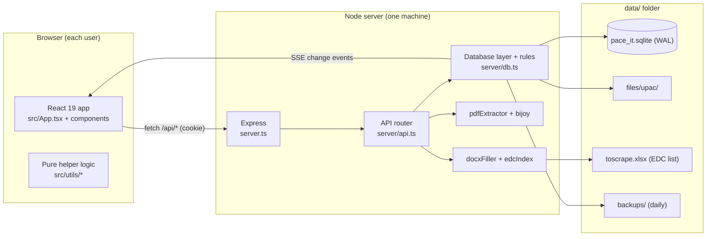

# Pace IT Management — Project Documentation

Architecture, data model, business rules and operations reference.

**Contents**

1. [What this project is](#1-what-this-project-is)
2. [Architecture](#2-architecture)
3. [Tech stack](#3-tech-stack)
4. [Folder map](#4-folder-map)
5. [The server](#5-the-server)
6. [The database](#6-the-database)
7. [Business rules](#7-business-rules-the-why-does-it-do-that-chapter)
8. [The frontend](#8-the-frontend)
9. [Feature walkthroughs](#9-feature-walkthroughs)
10. [Data safety: backups, restore, crash behaviour](#10-data-safety)
11. [Security model](#11-security-model)
12. [Configuration & deployment](#12-configuration--deployment)
13. [Developer workflow](#13-developer-workflow)
14. [History & legacy leftovers](#14-history--legacy-leftovers)
15. [Known issues & ideas](#15-known-issues--ideas)
16. [Troubleshooting](#16-troubleshooting)
17. [Glossary](#17-glossary)

---

## 1. What this project is

**Pace IT Management** is an internal web app for an ISP team in **Sylhet, Bangladesh**. The company connects **institutes** — primary schools, high schools, colleges, madrasas, health centres, union offices and government offices — to the internet. Field work is done by contractors called **foremen**, spread across the **13 upazilas** of Sylhet district.

For every connection there is paperwork (the **EDC / UPAC form**), a router (serial + MAC), a location (lat/long), fibre length, a monthly **bill**, and a "problem diary" (what went wrong, what we did, who we told). This app is the single shared source of truth for all of it.

### Who uses it
| Role | Typical person | Can do |
|---|---|---|
| **User ("Operator")** | Support / data-entry staff | Create & edit records, import, generate forms, mark forms/bills (as *requests*), manage foremen |
| **Admin** | Supervisor | Everything above, **plus** approve requests & imports, create accounts, use the Bin, restore/clear data, grant "roam" to foremen |

### Main capabilities
- Connection records with full per-field **change history**
- Fast search / filters / sort / print / PDF & Excel export
- **UPAC PDF reader** (auto-extracts institute, EDC no., NMS ID, MAC, serial, lat/long…)
- **Form Maker**: EDC number → institute lookup → filled **Word** form
- **Forms** and **Bills** reconciliation (received / awaiting, per foreman, per month)
- **Approval workflow** for forms, bills and CSV imports
- **Coverage analytics** per upazila and union, with inline data-fixing
- Foreman directory with teams and supply stats
- **Live multi-user updates**, activity feed, admin Bin, backups

---

## 2. Architecture



**Key design choices (and why):**

| Choice | Reason |
|---|---|
| **Single Node process + SQLite file** | Tiny team, one office. No database server to install, easy to back up (copy a file). |
| **Node's built-in `node:sqlite`** | No native compiler or npm database package needed; works the same on Windows and Linux. Needs Node ≥ 22.16. |
| **Server holds all rules** | Approvals, history, soft-delete and numbering are enforced server-side, so the UI can't bypass them. |
| **Server-Sent Events for live updates** | Simple one-way "something changed" ping; clients re-fetch. Far simpler than WebSockets for this need. |
| **Whole logs list fetched at once** (ETag + gzip) | At a few thousand records, filtering/sorting in the browser is instant and the code stays simple. |
| **Business helpers shared between client & server** (`utils/category.ts`, `utils/upazilas.ts`) | The same category / upazila logic runs in both places, so results never disagree. |
| **Soft delete + Bin** | Mistakes are recoverable. |
| **Attached PDFs as files, not DB blobs** | Keeps the database small and fast; simple to mirror in backups. |

### How a typical save flows
1. User edits a record → `LogForm` calls `PATCH /api/logs/:id`.
2. `api.ts` authenticates (cookie) → `db.patchLog` → `db.saveLog`.
3. `saveLog` diffs old vs new, appends a `history` entry, writes SQL, updates the activity feed, harvests autocomplete suggestions, and calls `notify('logs')`.
4. `notify` bumps an in-memory **revision** counter (invalidates the `GET /logs` cache) and emits an event.
5. The response hook flushes to disk, then returns.
6. Every browser connected to `/api/events` receives `{type:'logs'}` → after ~300 ms it re-fetches `/api/logs` (a cheap `304` if nothing changed for it).

---

## 3. Tech stack

| Layer | Technology |
|---|---|
| Language | TypeScript (ES modules) |
| Frontend | React 19, Vite, Tailwind CSS 4, `lucide-react` icons |
| Backend | Node ≥ 22.16, Express 4, run with `tsx` (no separate compile step) |
| Database | SQLite via `node:sqlite` (WAL mode) |
| PDF reading | `pdfjs-dist` (text layer only) + own Bijoy→Unicode converter |
| Word output | `adm-zip` + direct edit of the template's `document.xml` |
| Exports | `jspdf` + `jspdf-autotable` (PDF), `xlsx` (Excel; also reads the EDC list) |
| Fonts | Fustat (Google Fonts), **Nikosh** (bundled; for Bangla in PDFs) |

Scripts (`package.json`):

| Command | What it does |
|---|---|
| `npm run dev` | Server + Vite with hot reload (never watches `data/`) |
| `npm run build` | Builds the frontend into `dist/` |
| `npm start` | Runs the server; serves `dist/` if it exists (else falls back to dev mode with a notice) |
| `npm run backup -- <folder>` | Full backup (DB + attachments) |
| `npm run lint` | `tsc --noEmit` type-check |
| `npm run clean` | Removes `dist` and `server.js` |

---

## 4. Folder map

```
paceit/
├─ server.ts                 Entry point: Express, HTTPS auto-switch, body-size limits, static/Vite serving
├─ server/
│  ├─ api.ts                 All /api routes, auth middleware, login rate limiter, SSE stream
│  ├─ db.ts                  SQLite layer: schema, migrations, every business rule, backups, seeding
│  ├─ pdfExtractor.ts        UPAC PDF → fields (label-based, no network)
│  ├─ bijoy.ts               Legacy Bijoy (SutonnyMJ) text → Bangla Unicode
│  ├─ docxFiller.ts          Fills template/EDC Form.docx; Bangla date/digits; MAC cleaning
│  └─ edcIndex.ts            Loads/caches the EDC institute list (xlsx or index.json)
├─ scripts/backup.ts         `npm run backup`
├─ template/EDC Form.docx    The Word template Form Maker fills
├─ src/
│  ├─ main.tsx               Root: checks session → LoginScreen or App
│  ├─ App.tsx                App shell: state, data loading, live updates, view switching
│  ├─ brand.ts               Name, slogan, description
│  ├─ types.ts               Shared TypeScript types
│  ├─ index.css              Tailwind + print styles
│  ├─ components/            One file per screen/dialog (see §8)
│  ├─ utils/                 Pure logic + API client (see §8)
│  ├─ fonts/Nikosh.ttf       Bangla font for PDF export
│  └─ logo/                  Logo images
├─ index.html · vite.config.ts · tsconfig.json · package.json
└─ data/                     (NOT in the repo — created at runtime; see README for contents)
```

---

## 5. The server

### 5.1 `server.ts` — startup
1. Decides **HTTP vs HTTPS**: if `data/certs/cert.pem` and `key.pem` (or `SSL_CERT`/`SSL_KEY`) exist → HTTPS, adds an HSTS header, and marks cookies `Secure`.
2. **Body-size limits** (see API doc §1.4): 50 MB only for the file-carrying POST routes, 2 MB for everything else. Oversize → clean JSON `413`; malformed JSON → `400`.
3. Mounts `/api` → `server/api.ts`.
4. Serves the frontend:
   - **Built mode** (default when `dist/index.html` exists): static files + SPA fallback.
   - **Dev mode** (`--dev`, or no build found): Vite middleware with hot reload; ignores `data/`, `*.sqlite*`, `dist/`.
5. Listens on `HOST` (default `0.0.0.0`) : `PORT` (default 3000).
6. 50 ms after start, pre-loads the EDC workbook so the first Form Maker lookup is instant.

### 5.2 `server/api.ts` — the router
In order of execution for every request:

1. **Flush hook** — for non-GET requests, wraps `res.end` so the DB is flushed before the reply goes out. *(Today `flush()` is a no-op because native SQLite commits each statement immediately; the hook is kept for safety.)*
2. **`db.ready()`** — waits for initialisation/migrations.
3. Per-route **`authMiddleware`** (valid, unexpired, correctly-signed cookie *and* an enabled account) and, where needed, **`adminMiddleware`**.

Other responsibilities: login **rate limiter** (in memory), **admin-password confirmation** helper for dangerous actions, the **SSE** endpoint, the **PDF scan** loop, and the **Form Maker** routes (`/meta`, `/lookup`, `/generate`).

Full endpoint list: **[API.md](API.md)**.

### 5.3 Sessions
- Token = `userId.expiresAtMs.HMAC-SHA256(secret)`; 30-day life; carried only in an HttpOnly, SameSite=Lax cookie.
- Secret = 32 random bytes in `data/pace_it_secret.key` (auto-created).
- **Stateless:** there is no session table. Disabled accounts are rejected because `getUserById` returns `null` for them.

### 5.4 `server/pdfExtractor.ts` — reading UPAC PDFs
1. `pdfjs` loads **page 1**, collects every text piece with its x/y.
2. Pieces with (almost) the same y become one **visual line**; sorted left→right.
3. Fields are found by their **fixed English labels** ("EDC Book No.", "Lat & Long", "Wi-Fi Router Serial No.", …), identical on every UPAC form.
4. Bangla values (institute / union / upazila) are usually legacy **Bijoy** text → `bijoy.ts` converts to Unicode (handles pre-kar vowel signs, half-forms, reph, digits).
5. If a PDF's Bangla layer is corrupted, the value is **looked up in the EDC index by EDC Book No.** and a warning says so.
6. Output: the fields + `confidence` (fraction of 9 key fields found) + `warnings[]` (what needs a human check).

Limits: **text-layer PDFs only.** Scanned images return a clear error. Always glance at `warnings`.

### 5.5 `server/edcIndex.ts` — the institute list
- Source priority: `data/toscrape.xlsx` (or any `.xlsx` in `data/`, preferring a name containing "toscrape") → `data/index.json`.
- Columns are found **from the header row**, so re-ordering columns in the workbook doesn't break it.
- Cached (also to `data/edc-cache.dat`) and **re-read automatically when the file changes** — no restart needed.
- Shape: `{ "<EDC no>": [ { sheet, data: { name, mobile, union, upazila, source_no, connection_nms, institution_code, lat_long, router_serial, router_mac } } ] }`.

### 5.6 `server/docxFiller.ts` — the Word form
- Opens `template/EDC Form.docx` as a zip, edits `word/document.xml` paragraph by paragraph.
- Recognises each paragraph by its (Unicode **NFC-normalised**) Bangla/English label and appends the value; fixes the header line (source no. + Bangla date); sets cable brand/qty; inserts the institute name into the site-visit sentence.
- Dates become Bangla digits (`১১/১০/২০২৬`). MACs are cleaned to a standard format.
- ⚠️ **If you edit the Word template, the label text must stay the same**, or the matching paragraph won't be filled.

---

## 6. The database

File: `data/pace_it.sqlite`. Opened with `synchronous=FULL`, `busy_timeout=5000`, WAL, and a **`quick_check` on every start**. If the file exists but can't be opened, the server **refuses to start** (rather than silently creating an empty DB over real data) and tells you to restore from backup.

### 6.1 Tables
| Table | Purpose | Key columns |
|---|---|---|
| `users` | Accounts | `username` (unique), `display_name`, `password` (scrypt hash), `role`, `disabled`, `phone_number`, `email`, `photo_url` |
| `logs` | Connection records | `id`, `log_no`, `date`, `foreman_*`, `customer_name`, `name_bn/en`, `nms_id`, `edc_no`, `mac`, `router_serial`, `lat/long`, `union_name`, `upazila`, `category`, problem-diary columns, `form_received_at`, `bill_received_at`, `bill_months` (JSON), `upac_form_*` metadata, `deleted_at/by`, audit columns, `history` (JSON) |
| `foremen` | Field contractors | `name` (**UNIQUE**), `area` (upazila key), `phone`, `photo_url`, `active`, `roam`, `roam_areas`, `deleted_at/by` |
| `team_members` | People under a foreman | `foreman_id`, `name`, `phone`, `role`, `active`, `deleted_at/by` |
| `approvals` | Pending/decided form & bill marks | `log_id`, `kind`, `action`, `status`, `month`, `received_on`, `requested_by(_id)`, `decided_*` |
| `import_requests` | CSV imports awaiting approval | `entry_count`, `sample`, `payload` (the parsed entries as JSON), `status` |
| `suggestions` | Autocomplete lists | `field` → `values_json` |
| `activity` | Shared activity feed | `at`, `by_user`, `action`, `log_no`, `customer`, `detail` |

Indexes on `logs`: `deleted_at`, `log_no`, `nms_id`, `edc_no`, `foreman_id`, `created_at`, `status`, `upazila`, `category`.

### 6.2 Where things physically live
| Thing | Location |
|---|---|
| Attached UPAC PDFs | `data/files/upac/<log id, sanitised>` (plain files) |
| User & foreman photos | In the DB as compressed JPEG **data-URLs** (client shrinks to ≤ 900 px) |
| Per-record history | JSON text in `logs.history` |
| Months a bill was received | JSON array in `logs.bill_months` |

### 6.3 Migrations (run automatically on every start; all safe to re-run)
The schema is "create if missing, then add any missing columns". One-time data fixes use SQLite's **`PRAGMA user_version`**:

| `user_version` | What it did |
|---|---|
| 2 | Back-filled the auto-detected `category` on every log |
| 3 | Marked the 162 bills received so far as the **September 2026** bills |
| 4 | Moved "Degree College" records to **National University** (only those still on the automatic result) |

Plus non-versioned, idempotent steps: reseller→foreman schema rename (keeps a `…before-foreman-code-rename` copy first), wording rename, PoP-feature removal (keeps `…before-pop-removal`), foreman upazila normalisation, plain-text password → scrypt hash upgrade, institute-name backfill into the right-language field.

### 6.4 Seed data
- On first run, an **`admin`** account is created with a **random password printed once** in the console. (If an existing admin still has a known default like `admin1234`, a warning is printed at start.)
- **44 foremen** are seeded by name/area/phone on every start (existing ones are only filled in where area/phone are empty).
- Default autocomplete lists (`INITIAL_SUGGESTIONS`) are inserted if the table is empty.

---

## 7. Business rules (the "why does it do that?" chapter)

### 7.1 Record numbering & identity
- `id` = UUID. `logNo` = next number (`MAX(log_no)+1`) unless given. Batch saves number consecutively.

### 7.2 Change history
- On every edit, the server compares ~31 tracked fields; if anything changed it appends `{at, by, action:'edited', changes:[{field, from, to}]}` and updates `updatedAt/By`. No change → no history entry.
- Form/bill marks write their own history entry (`formReceivedAt`, `billMonths`).

### 7.3 Approval workflow (forms & bills)
```
user marks "received"
   ├─ admin?  → applied immediately
   └─ user    → row in `approvals` (status = pending)
                    ├─ admin approves → mark applied, request closed
                    ├─ admin rejects  → request closed
                    └─ requester/admin withdraws → request deleted
```
- Bills are per **month** (`YYYY-MM`); a record can have several received months. `billReceivedAt` = when the latest one came in.
- Forms are per **date**. A normal edit/save can **never** change `formReceivedAt`/`billReceivedAt`/`billMonths` — only this flow can.
- A newer pending request for the same record + kind (+ month) replaces the older one.
- A log "**expects a form**" if its request type contains "new user" or "form", or it has an EDC no. A form is **overdue** after a configurable number of days.

### 7.4 CSV imports
Normal user's CSV → parsed in the browser → stored as an `import_requests` row → **admin approves** → saved as one batch transaction. Admin imports go straight in.

### 7.5 Soft delete & the Bin
`DELETE` sets `deleted_at/by` and logs activity. Only admins see the Bin, can **restore** or **delete forever** (which also removes the attached PDF file). "Clear all" moves everything to the Bin and needs the admin password.

### 7.6 Restore from a backup file (JSON)
Admin + password (except the "local merge" case). *Replace* → current live logs go to the Bin first; *Merge* → upsert by `id`. Old "reseller…" keys are upgraded. Suggestions can be restored too.

### 7.7 Foremen, upazilas, "roam"
- Exactly **13 upazilas** are known (`src/utils/upazilas.ts`) with Bangla names and many spelling **aliases** (e.g. `Zakiganj` / `Jokigonj`). Anything typed is normalised to a canonical key.
- A foreman serves their **home upazila**. An admin can grant **roam** ("own broadband"): either any upazila, or a chosen list (`roamAreas`).
- A log's upazila = its foreman's upazila — except for a roaming foreman, where it's the **customer's** upazila recorded on the log.
- Two foremen with the same name → the log shows `Name (Upazila)` to tell them apart.
- EDC area codes such as `36.EDC-Sylhet-Sadar-Liton` are parsed to find the foreman + upazila (used by the CSV importer).

### 7.8 Automatic category
Keyword rules on the institute name (first match wins, whitespace/diacritic-insensitive, Bangla + English):
**National University → Madrasa → Primary → Secondary → Health → Govt. Organization → Land Reform Board.**
(Education is checked before "Union", so *Union High School* is Secondary, not Land Reform.) A hand-picked category is never overwritten.

### 7.9 Suggestions (autocomplete)
Every saved value is "harvested" into the per-field suggestion lists, so dropdowns learn from real use. Admins can edit the lists.

### 7.10 Coverage counting
Computed live from the records (nothing stored). Unions are counted **exactly as written** (only whitespace/zero-width characters are cleaned) so typos stay visible; fix one by renaming a union in the Coverage screen (bulk) or editing the record.

### 7.11 Dates & time
Timestamps are stored as UTC ISO; displayed in **Asia/Dhaka**, 12-hour. A log's own `date` is free text ("10 Oct 2026"); the app parses several formats (`utils/dates.ts`).

---

## 8. The frontend

### 8.1 Shell
- `main.tsx` → asks `/auth/me`. No session → **`LoginScreen`** (with an animated map of the 13 upazilas, `LoginStage`; logging in through the "admin door" opens the Admin panel straight away). Session → **`App`**.
- `App.tsx` holds nearly all shared state (logs, foremen, team members, approvals, import requests, suggestions, activity, avatars, filters, current view), loads it through `utils/cloud.ts`, and re-loads parts when the SSE stream says so (`subscribeToCloud`). It falls back to polling if SSE fails.
- Views: `home · sheet · form · maker · directory · bills · forms · requests · coverage`. The current view is remembered **per browser tab** (`sessionStorage`), so a refresh keeps the current page.

### 8.2 Components (`src/components/`)
| Area | Files |
|---|---|
| Layout & chrome | `Sidebar`, `AccountMenu`, `DevelopedBy`, `ScrollLock`, `ConfirmDialog`, `ImageLightbox` |
| Login | `LoginScreen`, `LoginStage` |
| Dashboard | `Dashboard` |
| Records | `LogsToolbar` (search/filters/exports/imports), `LogList`, `LogSheetView` (one record, printable), `LogForm` (create/edit; duplicate warnings; autosave), `MonthSelect` |
| Import / bulk | `CsvImportModal`, `FieldFillModal`, `IdMatchNote`, `SuggestionInput`, `SuggestionsModal` |
| Forms & bills | `FormsTab`, `BillsPanel`, `RequestsTab` |
| Form Maker | `FormMaker` |
| Foremen | `ForemanDirectory`, `ForemanProfileModal` |
| Coverage | `CoverageAnalytics` |
| Admin & account | `AdminPanel` (Accounts · Bin · Security), `AdminPasswordDialog`, `ProfileModal`, `ChangePasswordModal`, `BackupModal`, `ActivityModal` |

### 8.3 Helpers (`src/utils/`)
| File | Job |
|---|---|
| `cloud.ts` | **The API client** (every `fetch`, cookie credentials, 401 → sign out, SSE subscription) |
| `auth.ts` | Login/logout/me; remembers the last username in `localStorage` |
| `category.ts`, `categoryStyle.ts` | Auto-category rules (shared with server) and colours |
| `upazilas.ts`, `foremen.ts` | Upazila list/aliases, roam logic, foreman matching |
| `csvImporter.ts` | CSV → log entries (dates, names, EDC area → foreman/upazila) |
| `bulkFill.ts`, `markIds.ts` | "Fill a field from a list" and paste-IDs matching (Bangla digits accepted) |
| `forms.ts`, `bills.ts`, `approvals.ts`, `months.ts` | Form/bill status maths, month keys, "waiting for admin" index |
| `completeness.ts` | What a *finished* record must contain; drives "missing info" filters |
| `duplicates.ts` | Warn on same MAC / router serial / NMS ID elsewhere |
| `followUps.ts`, `dates.ts`, `activity.ts` | Follow-up states (overdue/today/future), date parsing, Dhaka time formatting |
| `unionStats.ts` | Coverage statistics |
| `exportExcel.ts`, `exportPdf.ts` | Exports. **Bangla in PDFs is drawn by the browser (canvas + bundled Nikosh font) and placed as crisp images**, because jsPDF can't shape Bengali |
| `image.ts`, `names.ts`, `whatsapp.ts`, `useFitZoom.ts`, `storage.ts` | Image compression, Bangla/English name handling, WhatsApp links (`+880` normalisation), fit-to-box zoom, default suggestion lists |

---

## 9. Feature walkthroughs

### 9.1 Adding a connection
**New record** (`LogForm`) → fill institute, foreman, NMS ID, router, location, problem diary… → on save, the server numbers it, categorises it, logs activity. While editing an *existing* record, changes autosave in the background. Duplicate MAC/serial/NMS ID warnings point at the other records.

### 9.2 Reading a UPAC PDF
Drop PDFs → `POST /api/pdf/scan` → table of extracted values with confidence/warnings → review → apply to records (and optionally attach the PDF to the record via `/logs/:id/upac-form`).

### 9.3 Form Maker
1. Enter **EDC Book No.** → `GET /api/lookup` → institute details from the Excel list (name, union, upazila, mobile, code, router info…).
2. Adjust fields, pick the date → `POST /api/generate` → `.docx` downloads.
3. Only after a successful download, a **log is created/updated automatically** with everything the form knows. Re-downloading the same form in one session **updates** that log (no duplicates) and never wipes data typed in later.

### 9.4 Forms & Bills reconciliation
Per-foreman tables of *sent / received / awaiting* (forms) and *received per month* (bills). Mark one, many, or **paste a list of NMS IDs** — the screen reports exactly which IDs matched, which were already marked, and which have no record yet. Non-admin marks become requests (see §7.3).

### 9.5 Requests (admin inbox)
Pending form/bill marks **and** CSV imports in one place: approve/reject one or all. The sidebar badge shows the pending count. Requesters can withdraw their own.

### 9.6 "Fill a field from a list"
Pick a field (MAC, router serial, EDC no., lat/long, fibre length, union, upazila, head-teacher, names, remarks), paste NMS IDs (one per line) and values (same order) → `POST /logs/bulk-fill`. Each record is re-read first so concurrent edits aren't overwritten; one summary line goes to the activity feed.

### 9.7 Coverage
Cards per upazila → expand to unions with counts; "needs attention" panel lists records with no union/upazila. Fix inline: rename/merge a union across all its records, or edit single records. Jump to *Connection Records* filtered to that upazila.

### 9.8 Printing & exporting
- Single record: print sheet (copied into a dedicated print root so nothing else prints).
- List: **PDF** (Bangla-safe) and **Excel**.
- Admin backup: **JSON** (restorable) + Excel.

### 9.9 Admin panel
- **Accounts**: create users, disable/enable, reset password.
- **Bin**: restore or purge logs/foremen; empty the Bin.
- **Security**: change the admin password, and a **one-time local migration** that imports old connections saved in *this browser* (from the pre-server days) into the shared database.

---

## 10. Data safety

| Layer | What happens | Where |
|---|---|---|
| Every write | Committed to disk immediately (`synchronous=FULL`, WAL) | automatic |
| Integrity | `quick_check` at every start; refuses to open a damaged DB | automatic |
| Clean shutdown | On Ctrl+C / SIGTERM / window close, WAL is folded back into the main file | automatic |
| Daily DB copy | `data/backups/pace_it-YYYY-MM-DD.sqlite`, newest 30 kept (checked at most once a minute, written on first change of the day) | automatic — **same disk!** |
| **Full backup** | `npm run backup -- <folder>`: DB snapshot via SQLite online-backup **+** mirror of `files/upac` (add-only), verified, prints `BACKUP OK` | **you schedule it** |
| In-app export | Admin → Backup → JSON (restorable) / Excel | manual |
| Soft delete | Bin | automatic |

**What is *not* in the full backup:** `data/toscrape.xlsx` (keep your own copy), `data/pace_it_secret.key` (losing it only logs everyone out), `data/certs/`.

Backup order matters and is built in: **DB snapshot first, attachments after**, so every form the snapshot refers to is guaranteed to exist in the mirror.

Restore steps are in the README.

---

## 11. Security model

| Topic | What exists |
|---|---|
| Passwords | scrypt (N=16384, 16-byte random salt, 64-byte hash), constant-time compare; ≥ 8 characters; never stored in plain text (old plain-text DBs are auto-upgraded) |
| Sessions | HMAC-signed, 30-day, HttpOnly + SameSite=Lax cookie (+ Secure on HTTPS); no token in JS-readable storage |
| Brute force | 5 wrong tries → 15-minute lock (per IP + username); same for admin-password re-checks |
| Admin gate | Server-side `adminMiddleware`; destructive admin actions also need the admin password again |
| Disabled users | Cookie stops working immediately; the admin account itself can't be disabled |
| Input limits | Body-size caps, bulk-fill cap (5000), value cap (500 chars), SQL via bound parameters |
| Filenames | Sanitised for downloads and for on-disk attachment names |
| HTTPS | Auto-enabled by dropping cert/key into `data/certs`; HSTS sent |
| Network exposure | Default `0.0.0.0` (office LAN). Use `HOST=127.0.0.1` to restrict. **Designed for a trusted LAN — not hardened for the open internet** (see §15) |

---

## 12. Configuration & deployment

### Environment variables
| Variable | Default | Effect |
|---|---|---|
| `PORT` | `3000` | Listening port |
| `HOST` | `0.0.0.0` | Bind address (`127.0.0.1` = this machine only) |
| `NODE_ENV` | — | `production` forces built mode; `development` forces Vite dev |
| `SSL_CERT` / `SSL_KEY` | `data/certs/cert.pem` / `key.pem` | HTTPS files |
| `COOKIE_SECURE` | — | Set `1` when a reverse proxy provides HTTPS |
| `PACE_BACKUP_DIR` / `PACE_BACKUP_KEEP` | — / `30` | Defaults for `npm run backup` |

### Typical office deployment
1. Install Node ≥ 22.16 on the office PC/server.
2. Copy the project, put `toscrape.xlsx` into `data/`.
3. `npm install && npm run build && npm start` (run it as a service / startup task so it survives reboots).
4. Note the first-run admin password; change it.
5. Give colleagues `http://<server-ip>:3000`.
6. Schedule `npm run backup` nightly to **another drive**.

**Rules:** exactly **one** server per `data/` folder; `data/` on a **local disk**; run from the project folder (paths are relative to the working directory).

---

## 13. Developer workflow

```bash
npm install
npm run dev        # hot reload at http://localhost:3000
npm run lint       # type-check
npm run build      # REQUIRED before `npm start` shows your changes
```

Where to change things:

| I want to… | Edit |
|---|---|
| Add an API route | `server/api.ts` (+ a method in `server/db.ts`) |
| Add a column to logs | `db.ts`: `createTables` column list (the "add missing columns" array), `rowToLog`, `saveLog`/`writeExtras`; then `types.ts` and (if tracked in history) `fieldsToCheck` |
| Add an upazila / alias | `src/utils/upazilas.ts` |
| Change category rules | `src/utils/category.ts` (affects client **and** server) |
| Change the Word form | `template/EDC Form.docx` (keep label text!) and `server/docxFiller.ts` |
| Change Form Maker fields | `FORM_FIELDS` in `api.ts` + `docxFiller.ts` |
| Add a screen | New component → add to `View`/`VIEWS` and `Sidebar` items in `App.tsx` / `Sidebar.tsx` |
| Change branding | `src/brand.ts`, `index.html`, `src/logo/` |
| Call a new endpoint from the UI | Add a function in `src/utils/cloud.ts` |

---

## 14. History & legacy leftovers

Notes on earlier versions, useful when something looks unusual:

- **"Reseller" → "Supplier" → "Foreman".** The database is migrated automatically and old backups still import (`LEGACY_KEY_MAP`).
- **PoP feature removed.** A table and per-record fields were dropped on start-up (a `…before-pop-removal` copy is kept).
- **JSON → SQLite.** If a legacy `data/pace_it_db.json` exists, `db.ts` imports it on start-up; the app used to store everything in that JSON file.
- **Earlier SQLite engine → `node:sqlite`.** The `NativeDb` adapter keeps an older `run()/exec()` → `[{columns, values}]` call shape (it looks like the shape of the `sql.js` library), so the rest of `db.ts` didn't need rewriting.
- **`INITIAL_SUGGESTIONS`** exists twice (`server/db.ts` and `src/utils/storage.ts`) and contains sample/placeholder values.

---

## 15. Known issues & ideas

Observations from review. None cause crashes. Items marked ⚠️ are worth checking first.

| # | Observation | Suggestion |
|---|---|---|
| ⚠️1 | The **Admin → Security** tab still says *"The initial administrator password is admin"*, but the server now creates a **random** first-run password (printed once in the console). The message is outdated and misleading. | Update the text in `src/components/AdminPanel.tsx`. |
| ⚠️2 | Sessions can't be revoked: logout/password change don't invalidate a copied cookie (up to 30 days). | Add a per-user "token version" or session table. |
| 4 | Login throttle trusts `X-Forwarded-For` and lives in memory. | Fine on a LAN; fix before internet exposure. |
| 5 | Some admin-only UI actions aren't enforced by the API (`POST /suggestions`; foreman edits other than roam). | Add `adminMiddleware` where the UI implies it. |
| 6 | `/bin` permanent deletes don't require the admin password (only a UI confirm). | Optional: reuse `confirmAdminPassword`. |
| 7 | Whole `logs` list (with history) is sent to every browser. | OK to a few thousand rows; consider paging if it grows to tens of thousands. |
| 8 | Daily DB backup lives on the same disk; the full backup must be scheduled by hand. | Schedule `npm run backup` (README). |
| 9 | The EDC workbook (`toscrape.xlsx`) isn't created or backed up by the app. | Keep a copy elsewhere; document where it came from. |
| 10 | Seeded foremen list and default suggestions are hard-coded in `db.ts`. | Move to a data file if they change often. |
| 11 | There are no automated tests. | Start with `utils/category.ts`, `bijoy.ts`, `upazilas.ts`, `docxFiller` (pure functions). |

---

## 16. Troubleshooting

| Symptom | Likely cause / fix |
|---|---|
| `Cannot find module 'node:sqlite'` / start fails immediately | Node too old. Need **≥ 22.16** (`node -v`). |
| "The database file exists but could not be opened" | DB damaged or locked. **Don't delete anything.** Stop all servers, restore the newest backup (README), keep the old `data/` aside. |
| Forgot the admin password | The first-run password was only printed once. Another admin can reset it (Admin → Accounts). If none exists, reset the hash directly in the `users` table, or restore a backup. |
| I changed code but nothing changed | You're in built mode. Run `npm run build`. |
| Form Maker finds nothing | `data/toscrape.xlsx` missing or its header row isn't recognised (needs a "ক্রমিক"/serial column). Check `/api/lookup?edc=…` → `source` and `total`. |
| PDF scan says it can't read the file | It's a scanned image (no text layer). Fill the data by hand. |
| Bangla looks broken in PDF export | Fonts not loaded yet (`Nikosh` in `src/fonts`) — retry; check the font file is present in the build. |
| Everyone got logged out | `data/pace_it_secret.key` was deleted/regenerated, or the 30-day session expired. |
| Lost live updates | SSE blocked by a proxy that buffers streams (disable buffering for `/api/events`); the app falls back to polling. |
| "Run only one server per data folder" | Two servers on one SQLite file (or one on a network share) can corrupt it. Stop the extra one. |
| Page loads but login loops over HTTPS via proxy | Set `COOKIE_SECURE=1` (and make sure the proxy forwards cookies). Conversely, **don't** force Secure cookies on plain HTTP. |

---

## 17. Glossary

| Term | Meaning |
|---|---|
| **Upazila** | Sub-district. Pace IT covers 13 in Sylhet: Balaganj, Beanibazar, Bishwanath, Companiganj, Dakshin Surma, Fenchuganj, Golapganj, Gowainghat, Jaintiapur, Kanaighat, Osmani Nagar, Sylhet Sadar, Zakiganj. |
| **Union** | Smallest rural administrative unit under an upazila (also ward / pouroshova). |
| **EDC** | The programme/form series for institute connections; **EDC Book No. (সুত্র নং)** is the reference number. |
| **UPAC form** | The PDF connection certificate. |
| **NMS** | Network Management System; **NMS ID** = connection ID. |
| **EMIS / EIIN / DGHS** | Government institution codes (education / health). |
| **Foreman** | Field contractor supplying connections (formerly "reseller"). |
| **Roam / own broadband** | Admin-granted permission to supply outside the home upazila. |
| **Log** | One connection record. |
| **Bin** | Admin-only recycle bin for soft-deleted logs and foremen. |
| **SSE** | Server-Sent Events — the live-update channel (`/api/events`). |
| **WAL** | SQLite write-ahead log mode (files `-wal`, `-shm` next to the DB). |
| **Bijoy / SutonnyMJ** | A legacy Bangla font encoding that many PDFs still use; converted by `server/bijoy.ts`. |
